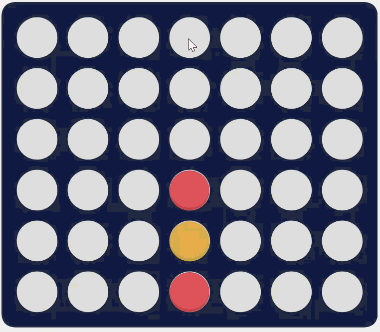

# Connect Four AI

An AI that taught itself Connect Four by playing against itself, and a small web app where you can play against it. It keeps learning from every game you play.

<p align="center">
  
</p>

## What's inside

- **The notebook** (`connect_four_deep_rl.ipynb`) trains the AI with deep reinforcement learning. It starts knowing only the rules and improves over thousands of games against itself. It also compares different ways of learning and tests the AI against other bots.
- **A stronger version** with a bigger network and a few moves of look-ahead. It beats a standard search bot (MCTS with 200 simulations) about 9 out of 10 times, against roughly 1 in 10 for the first version.
- **The web app** (`app.py`) lets you play against it in the browser. Every game is saved, and after each game the AI trains a little on what happened, so a trick that beat it once stops working.

## Play it

You need Python 3.10 or newer.

```bash
python -m venv .venv
.venv\Scripts\activate          # macOS/Linux: source .venv/bin/activate
pip install -r requirements.txt
streamlit run app.py
```

The app opens in your browser. Under **Settings** you can choose who moves first, how far the AI looks ahead, and whether it should keep learning.

It runs fine on a normal CPU. If you have an NVIDIA GPU, see `requirements.txt` for the faster install.

## Training it yourself

The trained models are already in `models/`. To train new ones, open the notebook in Google Colab with a GPU runtime and run all cells. It takes about an hour, and the last section downloads the new models.
